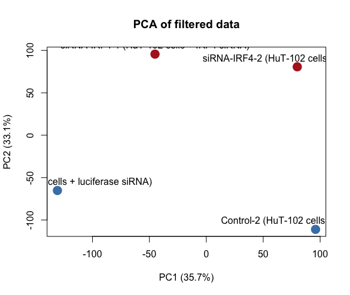
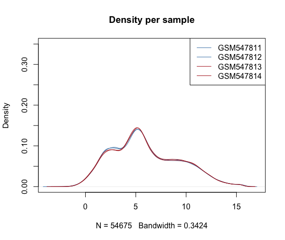

# IRF4 knockdown vs. control in human T cells: differential expression analysis of public microarray data (GSE22036)

## Question
Which genes' expression change when IRF4 gene is knocked down in T cells and what are the biological functions of these genes?
## What is IRF4
A transcription factor in lymphocyte differentiation and function. It is also linked to melanoma and pigmentation.
## Why was this question chosen?
In my internship, we are investigating the role of IRF4 knockout in melanoma cells. As a side project to improve my coding skills, I wanted to work on another cell line so that I have a deeper understanding on our target gene in different pathways.
## Data
- Dataset: GSE22036 (Refaat et al., 2010)
- Organism / Cell Type: Homo sapiens, HuT-102 cells (human cutaneous T cell lymphoma)
- Platform: GPL570	[HG-U133_Plus_2] Affymetrix Human Genome U133 Plus 2.0 Array
- Desing: -Control-1 
          -Control-2
          -siRNA-IRF4-1
          -siRNA-IRF4-2

## Methods
### 1. Loading
### 2. Quality Control
**Data:** GSE22036, 54,675 probesets, 4 samples (2 control, 2 IRF4 knockdown)

**Short Summary:** log2 transform, filtering, PCA, IRF4 KD check,

#### Scale check:
The raw values were not on a log scale (maximum far above 16), so
I applied a log2 transformation. After transforming, values ranged from about
-3 to 16, and the median was similar in all four samples (about 5.5), so the
arrays looked comparable.

#### Low-expression filtering: 
The density plot showed a first peak of probes with
background-level signal that ended at around log2 = 4. I kept only probes with
log2 expression > 4 in at least 2 samples (the size of one group, so that genes
expressed in only one condition are not lost).
- Probes before filtering: 54,675
- Probes removed: 13,441 (24.6%)
- Probes kept: 41,234 (75.4%)

#### PCA :
To answer the question "Do the samples differ from each other in the way I expect?"
If knockdown and control separate, the treatment changed the expression profile, and the comparison is worth running.
Resulst:
PC2 (33.1%) separates knockdown from control in both replicates, so the knockdown has an effect on the expression.
PC1 (35.7%) separates replicate 1 from replicate 2 in both groups, suggesting a replicate or batch effect.
No sample is a clear outlier, so none was excluded.

#### IRF4 Knockdown Check: 
To check whether the knockdown was visible at the transcript level, I looked
at the three probesets mapped to IRF4 (204562_at, 216986_s_at, 216987_at).
- 204562_at (the main, highly expressed IRF4 probeset): log2 expression was
  slightly lower in knockdown (12.57) than in control (12.88), a decrease of
  about 0.3 log2 units (roughly 19%).
- 216986_s_at: lower in knockdown (7.54 vs 8.08, about 31% lower), but this
  probeset has much lower expression.
- 216987_at: values near background level.
Interpretation: IRF4 expression decreased, however but the
effect on mRNA is modest and based on only 2 samples per group, so the
knockdown is only weakly supported at the transcript level. The PCA shows that
knockdown samples differ consistently from controls, so the treatment did
change the expression profile.
### 3.
### 4.

## Project structure

## Key results

## Limitations
Low statistical power since n = 2
IRF4 is not fully knockout, so some of it remains
Limitation form microarray analysis (low statistical power compared to RNA-seq)
## About this project
I did this analysis as a beginner project to learn bioinformatics.
I used an AI assistant to help me learn R and Git and to debug errors;
the choices and interpretation are mine.

## References
Refaat A, Zhou Y, Suzuki S, Takasaki I et al. Distinct roles of transforming growth factor-beta-activated kinase 1 (TAK1)-c-Rel and interferon regulatory factor 4 (IRF4) pathways in human T cell lymphotropic virus 1-transformed T helper 17 cells producing interleukin-9. J Biol Chem 2011 Jun 17;286(24):21092-9. PMID: 21498517. GEO accession GSE22036
